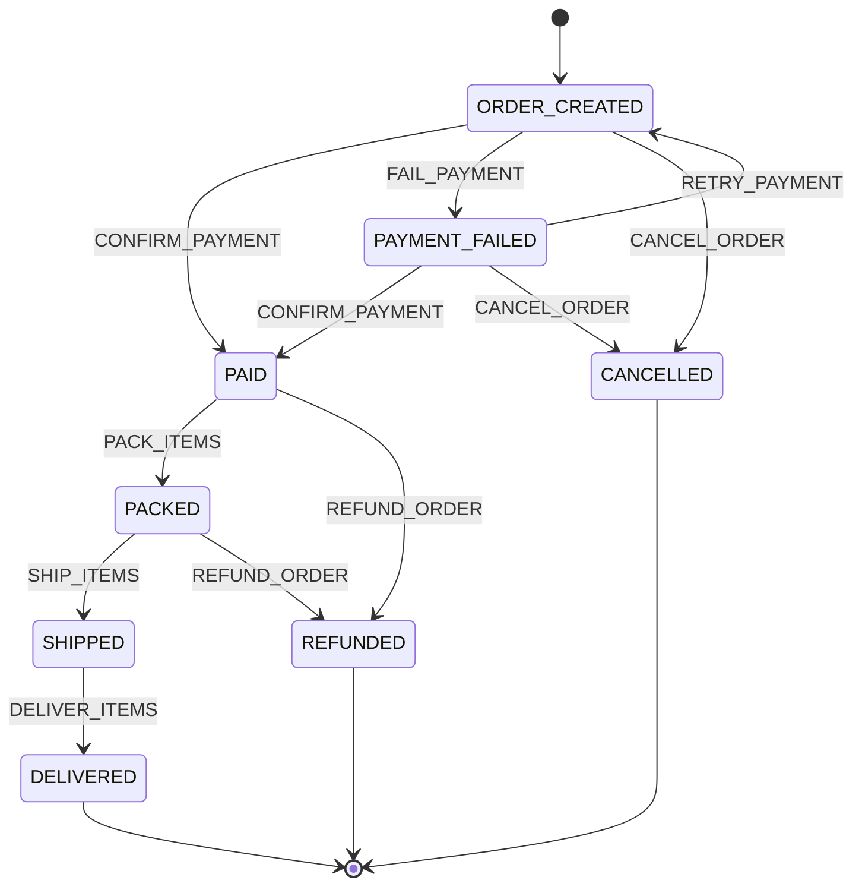

# Backend: Anomaly Detection in Process Workflows Using Automata and ML

This directory contains the production backend service for **Anomaly Detection in Process Workflows Using Automata and Machine Learning**. 

The system monitors and analyzes e-commerce order workflow event sequences using a hybrid, two-stage detection architecture:
1. **Deterministic Automata Engine (Finite State Machine):** Formally verifies structural lifecycle grammar, valid event transitions, and terminal state completion.
2. **Statistical Machine Learning Engine (Isolation Forest):** Unsupervised statistical outlier detection identifying behavioral anomalies (such as payment retry loops or abnormal event frequencies) among structurally valid workflows.

The findings from both engines are synthesized by a domain service layer into four mutually exclusive operational verdicts and exposed via a versioned **FastAPI** REST API.

---

## 1. Backend Directory Structure

```text
backend/
├── main.py                     # FastAPI application factory, lifespan management, and CORS middleware
├── requirements.txt            # Python dependencies
├── README.md                   # Backend documentation and architecture guide
├── toc_workflow.db             # Local SQLite database (stores analysis records and audit logs)
│
├── core/                       # Global configuration and environment settings
│   ├── __init__.py
│   └── config.py               # Central settings (DB URL, model paths, CORS origins, startup flags)
│
├── api/                        # HTTP interface layer (FastAPI)
│   ├── __init__.py
│   ├── routes.py               # API route definitions and endpoint handlers
│   ├── dependencies.py         # Dependency injection providers (get_db_session, get_service)
│   └── mapping.py              # Explicit ORM-to-Pydantic response mapper (record_to_response)
│
├── fsm/                        # Deterministic Automata Engine
│   ├── __init__.py
│   ├── states.py               # Order lifecycle states and event alphabet definitions
│   ├── transitions.py          # State transition matrix delta(s, e) & valid path rules
│   └── validator.py            # Sequential trace validator & transition violation detector
│
├── ml/                         # Statistical Machine Learning Engine
│   ├── __init__.py
│   ├── dataset/                # Dataset generation & data storage
│   │   ├── __init__.py
│   │   ├── generator.py        # 5,000-trace synthetic workflow dataset generator
│   │   └── data/
│   │       ├── .gitkeep
│   │       └── orders_workflow_dataset.csv # 5,000 generated labeled traces
│   ├── feature_extraction/     # Feature engineering
│   │   ├── __init__.py
│   │   └── extractor.py        # Extracts 14 numerical features from event sequences
│   ├── training/               # Model training pipeline
│   │   ├── __init__.py
│   │   └── train.py            # Isolation Forest training script (100 estimators, contamination='auto')
│   ├── inference/              # Online inference engine
│   │   ├── __init__.py
│   │   └── predictor.py        # Real-time scoring using serialized model and decision_function
│   ├── evaluation/             # Model evaluation & benchmarking
│   │   ├── __init__.py
│   │   ├── evaluate.py         # Evaluation metrics script (Precision, Recall, F1, ROC-AUC)
│   │   └── evaluation_results.json # Serialized evaluation benchmark metrics
│   └── models/                 # Model artifacts storage
│       ├── .gitkeep
│       ├── isolation_forest.joblib        # Serialized fitted IsolationForest estimator
│       └── isolation_forest_metadata.json # Metadata and feature configuration
│
├── pipeline/                   # Hybrid Decision Engine
│   ├── __init__.py
│   └── analyzer.py             # Two-stage analyzer coordinating FSM rules and ML inference
│
├── services/                   # Business Logic & Orchestration
│   ├── __init__.py
│   └── anomaly_service.py      # Service singleton with diagnostic enrichment and batch processing
│
├── database/                   # Data Persistence Layer (SQLite + SQLAlchemy 2.0)
│   ├── __init__.py
│   ├── connection.py           # Database engine, sessionmaker, and init_db()
│   ├── models.py               # SQLAlchemy ORM models (WorkflowAnalysis)
│   └── repository.py           # Repository CRUD operations, atomic transactions, and queries
│
├── schemas/                    # Data Validation & Serialization (Pydantic v2)
│   ├── __init__.py
│   ├── order.py                # Single & batch request schemas (WorkflowAnalysisRequest, etc.)
│   ├── anomaly.py              # Nested evaluation response schemas (AnalysisRecordResponse, etc.)
│   └── common.py               # Operational, health, metrics, pagination, and error schemas
│
├── tests/                      # Automated Test Suite (289 tests across 15 modules)
│   ├── conftest.py             # Pytest fixtures and test database setup
│   ├── test_fsm.py             # Automata transitions and validator tests (13 tests)
│   ├── test_dataset_generator.py # Synthetic dataset generation and allocation tests (12 tests)
│   ├── test_feature_extraction.py # 14-feature vectorization tests (13 tests)
│   ├── test_ml_training.py     # Isolation Forest training pipeline tests (12 tests)
│   ├── test_ml_inference.py    # Online scoring and validation tests (22 tests)
│   ├── test_ml_evaluation.py   # Benchmark evaluation tests (20 tests)
│   ├── test_hybrid_analyzer.py # Two-stage decision engine tests (16 tests)
│   ├── test_anomaly_service.py # Domain service and diagnostic enrichment tests (15 tests)
│   ├── test_database.py        # Repository, ORM, and transaction tests (31 tests)
│   ├── test_schemas.py         # Pydantic schema validation tests (44 tests)
│   ├── test_api_mapping.py     # ORM-to-Pydantic mapper tests (20 tests)
│   ├── test_api_dependencies.py # FastAPI dependency injection tests (5 tests)
│   ├── test_main.py            # App factory, lifespan, and CORS tests (12 tests)
│   ├── test_api.py             # REST API endpoint integration tests (41 tests)
│   └── test_e2e.py             # End-to-end integration & real-model smoke tests (13 tests)
│
└── docs/                       # Formal Specifications & Guides
    ├── WORKFLOW_SPEC.md        # Formal FSM workflow specification
    ├── DATASET_SPEC.md         # Synthetic dataset specification (v1.4)
    └── API_INTEGRATION_GUIDE.md # Frontend API integration guide
```

---

## 2. Directory & Component Responsibilities

| Directory / Module | Component Responsibility |
| :--- | :--- |
| `fsm/` | **Deterministic Workflow Validation:** Implements the finite state automaton: state enums, event alphabet $\Sigma$, transition matrix $\delta(s, e)$, and sequential trace validation with structured error reporting. |
| `ml/` | **Statistical Machine Learning:** Handles synthetic dataset generation (5,000 traces), 14-feature numerical extraction, Isolation Forest training, real-time inference scoring, and evaluation benchmarking. |
| `pipeline/` | **Hybrid FSM + ML Analysis:** Coordinates the two-stage decision logic. Routes traces through FSM validation first, determines ML eligibility, and synthesizes results into the 4-state verdict taxonomy. |
| `services/` | **Business Logic & Diagnostics:** Orchestrates single and batch analysis workflows, generates operational diagnostics (CRITICAL, WARNING, INFO), computes batch summaries, and provides service status without premature model loading. |
| `database/` | **Data Persistence & Queries:** Manages SQLite database connection, SQLAlchemy 2.0 ORM models (`WorkflowAnalysis`), atomic batch transactions with rollback, query filtering, and summary metrics. |
| `api/` | **REST Interface & Mapping:** FastAPI route handlers, dependency injection providers (`get_db_session`, `get_service`), and defensive ORM-to-Pydantic response mapping (`record_to_response`). |
| `schemas/` | **Request & Response Contracts:** Pydantic v2 models enforcing strict input validation, verbatim raw trace preservation, nested evaluation outputs, and standardized error envelopes. |
| `tests/` | **Automated Testing:** 289 automated tests covering unit testing, repository queries, schema edge cases, REST API endpoints, and end-to-end integration with in-memory database isolation. |
| `docs/` | **Technical Documentation:** Authoritative specifications for workflow automata (`WORKFLOW_SPEC.md`), synthetic dataset allocation (`DATASET_SPEC.md`), and frontend REST API integration (`API_INTEGRATION_GUIDE.md`). |

---

## 3. Workflow Lifecycle (Finite State Machine)

The order workflow is formally modeled as a deterministic Finite State Machine $M = (Q, \Sigma, \delta, q_0, F)$ where:
- **States ($Q$):** 8 states (`ORDER_CREATED`, `PAYMENT_FAILED`, `PAID`, `PACKED`, `SHIPPED`, `DELIVERED`, `CANCELLED`, `REFUNDED`).
- **Input Alphabet ($\Sigma$):** 8 order events (`CONFIRM_PAYMENT`, `FAIL_PAYMENT`, `RETRY_PAYMENT`, `CANCEL_ORDER`, `PACK_ITEMS`, `SHIP_ITEMS`, `DELIVER_ITEMS`, `REFUND_ORDER`).
- **Initial State ($q_0$):** `ORDER_CREATED`.
- **Terminal States ($F$):** `DELIVERED`, `CANCELLED`, `REFUNDED` (no outgoing transitions permitted).

### State Transition Diagram



### Transition Table ($\delta: Q \times \Sigma \to Q$)

There are exactly 11 valid transitions defined in `backend/fsm/transitions.py`:

| # | Current State | Event | Next State | Notes |
| :-: | :--- | :--- | :--- | :--- |
| 1 | `ORDER_CREATED` | `CONFIRM_PAYMENT` | `PAID` | Successful initial payment |
| 2 | `ORDER_CREATED` | `FAIL_PAYMENT` | `PAYMENT_FAILED` | Gateway or bank decline |
| 3 | `ORDER_CREATED` | `CANCEL_ORDER` | `CANCELLED` | Customer cancels before payment |
| 4 | `PAYMENT_FAILED` | `RETRY_PAYMENT` | `ORDER_CREATED` | Customer initiates retry loop |
| 5 | `PAYMENT_FAILED` | `CONFIRM_PAYMENT` | `PAID` | Direct recovery after failure |
| 6 | `PAYMENT_FAILED` | `CANCEL_ORDER` | `CANCELLED` | Customer abandons order |
| 7 | `PAID` | `PACK_ITEMS` | `PACKED` | Warehouse fulfillment starts |
| 8 | `PAID` | `REFUND_ORDER` | `REFUNDED` | Post-payment cancellation/refund |
| 9 | `PACKED` | `SHIP_ITEMS` | `SHIPPED` | Order dispatched with carrier |
| 10 | `PACKED` | `REFUND_ORDER` | `REFUNDED` | Warehouse recall/cancellation |
| 11 | `SHIPPED` | `DELIVER_ITEMS` | `DELIVERED` | Order successfully completed |

---

## 4. Hybrid FSM + ML Architecture

The system uses a sequential, two-stage evaluation pipeline to ensure both formal correctness and behavioral sensitivity:

```text
                        Incoming Event Sequence
                                  │
                                  ▼
                     [Stage 1: FSM Validator]
                                  │
         ┌────────────────────────┼────────────────────────┐
         │ (Invalid transition    │ (Valid transition      │ (Valid sequence
         │  or missing start)     │  prefix, non-terminal) │  reaching terminal)
         ▼                        ▼                        ▼
  RULE_VIOLATION           VALID_INCOMPLETE          [Stage 2: ML Engine]
(ML evaluation skipped)  (ML evaluation skipped)     (Isolation Forest)
                                                           │
                                             ┌─────────────┴─────────────┐
                                             │ inlier (score <= 0)       │ outlier (score > 0)
                                             ▼                           ▼
                                          NORMAL                STATISTICAL_ANOMALY
```

### Evaluation Logic & Verdict Definitions:

1. **`RULE_VIOLATION` (FSM Invalid):**
   - The trace violates transition rules (e.g., `DELIVER_ITEMS` before `PACK_ITEMS`), begins in an invalid state, or contains unknown tokens.
   - **ML Evaluation:** Skipped. Structural invalidity preempts statistical analysis.
   - **Diagnostic Severity:** `CRITICAL`.

2. **`VALID_INCOMPLETE` (FSM Valid, Non-Terminal):**
   - The trace strictly follows valid FSM transitions but terminates in a non-terminal state (e.g., `ORDER_CREATED`, `PAYMENT_FAILED`, `PAID`, `PACKED`, or `SHIPPED`).
   - Represents an active order currently in progress.
   - **ML Evaluation:** Skipped. Incomplete traces cannot be judged on sequence-wide feature volume.
   - **Diagnostic Severity:** `INFO`.

3. **`NORMAL` (FSM Valid, Complete, ML Inlier):**
   - The trace is FSM-valid, reaches a terminal state (`DELIVERED`, `CANCELLED`, or `REFUNDED`), and its statistical feature vector is evaluated by the Isolation Forest as an inlier (`anomaly_score <= 0.0`).
   - **Diagnostic Severity:** `INFO`.

4. **`STATISTICAL_ANOMALY` (FSM Valid, Complete, ML Outlier):**
   - The trace strictly satisfies all FSM transition rules and reaches a valid terminal state, but exhibits statistically unusual behavioral features (e.g., elevated payment retry loops `FAIL_PAYMENT` $\to$ `RETRY_PAYMENT` or abnormal sequence length).
   - **Diagnostic Severity:** `WARNING`.

> **Key Architectural Principle:** The ML model does not replace FSM validation. The FSM acts as a deterministic filter, and the Isolation Forest detects behavioral friction exclusively among eligible, structurally valid and complete traces.

---

## 5. Machine Learning Pipeline Details

### Approved Configuration
- **Algorithm:** Isolation Forest (`sklearn.ensemble.IsolationForest`)
- **Hyperparameters:**
  - `n_estimators = 100`
  - `contamination = "auto"`
  - `random_state = 42`
- **Training Samples:** 2,800 `NORMAL` traces only (unsupervised learning on normal baseline executions)

### Synthetic Dataset Allocation (5,000 Traces Total)
The dataset generator (`backend/ml/dataset/generator.py`) generates exactly 5,000 traces adhering to `DATASET_SPEC.md` (v1.4):

| Category | Split / Role | Trace Count | Evaluated By |
| :--- | :--- | :---: | :--- |
| `NORMAL` | Training set | 2,800 | Isolation Forest training |
| `NORMAL` | Primary test set (negative class) | 700 | Isolation Forest testing |
| `STATISTICAL_ANOMALY` | Primary test set (positive class) | 500 | Isolation Forest testing |
| `RULE_VIOLATION` | FSM benchmark set | 1,000 | FSM validator (excluded from ML test metrics) |
| **Total** | | **5,000** | |

### Extracted Numerical Features (Exactly 14)
The feature extractor (`backend/ml/feature_extraction/extractor.py`) computes 14 numeric features from event sequences in deterministic canonical order:

1. `seq_length`: Total number of events in the trace.
2. `count_CONFIRM_PAYMENT`: Occurrences of `CONFIRM_PAYMENT`.
3. `count_FAIL_PAYMENT`: Occurrences of `FAIL_PAYMENT`.
4. `count_RETRY_PAYMENT`: Occurrences of `RETRY_PAYMENT`.
5. `count_CANCEL_ORDER`: Occurrences of `CANCEL_ORDER`.
6. `count_PACK_ITEMS`: Occurrences of `PACK_ITEMS`.
7. `count_SHIP_ITEMS`: Occurrences of `SHIP_ITEMS`.
8. `count_DELIVER_ITEMS`: Occurrences of `DELIVER_ITEMS`.
9. `count_REFUND_ORDER`: Occurrences of `REFUND_ORDER`.
10. `retry_ratio`: Ratio of retry events to total payment failure attempts.
11. `payment_failure_rate`: Ratio of payment failures to total sequence length.
12. `bigram_FAIL_to_RETRY`: Count of consecutive `FAIL_PAYMENT;RETRY_PAYMENT` transitions.
13. `bigram_PACK_to_SHIP`: Count of consecutive `PACK_ITEMS;SHIP_ITEMS` transitions.
14. `unique_event_count`: Number of distinct event types observed in the trace.

### Anomaly Score Semantics
- **Calculation:** `anomaly_score = float(-estimator.decision_function(X)[0])`
- **Interpretation:** Higher positive values indicate greater anomaly. Scores $> 0.0$ are classified as anomalies (`is_ml_anomaly = True`), while scores $\le 0.0$ represent normal executions.
- **Important Note:** Anomaly scores are raw distance-based scores derived from decision tree path lengths; they are **not probabilities** and are **not bounded between -1 and 1**.

---

## 6. Technology Stack

- **Python 3.10+**: Core backend runtime (verified with Python 3.13).
- **FastAPI (>=0.110.0)**: Modern web framework for high-performance REST APIs with auto-generated OpenAPI documentation.
- **Uvicorn (>=0.28.0)**: ASGI web server for production and development.
- **Scikit-learn (>=1.4.0)**: Isolation Forest estimator for unsupervised anomaly detection.
- **Pandas (>=2.2.0) & NumPy (>=1.26.0)**: Feature extraction, matrix processing, and dataset manipulation.
- **Joblib (>=1.3.0)**: Model artifact serialization and loading.
- **SQLite**: Local, zero-configuration relational database engine.
- **SQLAlchemy 2.0 (>=2.0.25)**: ORM modeling, transactional integrity, and query compilation.
- **Pydantic v2 (>=2.6.0)**: High-performance data validation and serialization.
- **Pytest (>=8.0.0) & Unittest**: Automated test runners.
- **HTTPX (>=0.27.0)**: Client library supporting FastAPI's `TestClient`.

---

## 7. Backend Setup and Execution (Windows PowerShell)

All commands are executed from the project root directory (`c:\Users\SUPRATEEK\TOC_PROJECT`).

### 1. Create and Activate Virtual Environment
```powershell
# Create virtual environment
python -m venv .venv

# Activate virtual environment in PowerShell
.\.venv\Scripts\Activate.ps1
```

### 2. Install Dependencies
```powershell
pip install -r backend/requirements.txt
```

### 3. Run the Development Server
```powershell
python -m uvicorn backend.main:app --host 127.0.0.1 --port 8000 --reload
```

### 4. Access Interactive API Documentation
- **Swagger UI:** [http://127.0.0.1:8000/docs](http://127.0.0.1:8000/docs)
- **ReDoc:** [http://127.0.0.1:8000/redoc](http://127.0.0.1:8000/redoc)
- **OpenAPI Schema:** [http://127.0.0.1:8000/openapi.json](http://127.0.0.1:8000/openapi.json)

### 5. Run the Automated Test Suite
The backend contains 289 automated tests covering all modules:

```powershell
# Run with Python standard unittest discovery
python -m unittest discover -s backend/tests -v

# Or run with pytest
pytest backend/tests -v
```

---

## 8. API Integration Guide Reference

For detailed endpoint contracts, request/response JSON payloads, CORS policies, and frontend integration code snippets, refer to:

👉 **[API Integration Guide](docs/API_INTEGRATION_GUIDE.md)**

The guide covers:
- Complete specifications for all 10 exposed endpoints (liveness, readiness, analysis, batch, retrieval, history, pagination, and metrics).
- Request formats supporting structured items, delimited strings, and token lists.
- Standardized nested error envelope (`ErrorResponse`).
- CORS development origins (`http://localhost:3000`, `http://localhost:5173`) and restricted methods/headers.
- Ready-to-use TypeScript `fetch()` integration examples.
- UI rendering recommendations for status badges, FSM error diagnostics, and ML scores.
